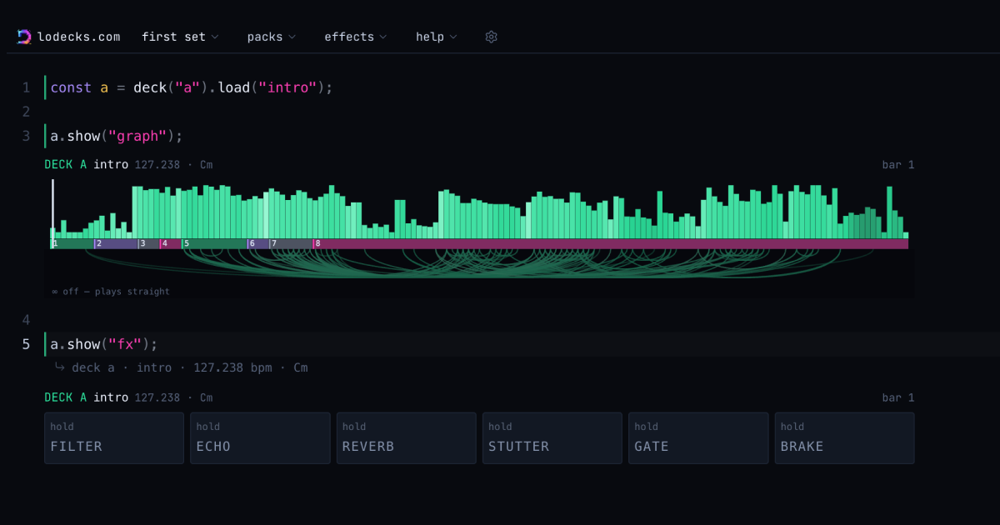

# lodecks



**Don't play the music. Hack it.**

A live coding DJ playground. Remix tracks, manipulate stems, and create
reactive visuals (all from code). It runs in your browser, in real time,
and everything stays in sync.

Write a line, hit `⌘↵`, and hear it come alive. Decks, sliders, pads and
visuals appear right under the code that made them. **Your code is your
controller.**

Play it at [lodecks.com/play](https://lodecks.com/play), or read the docs at
[lodecks.com/docs](https://lodecks.com/docs).

## Run it locally

```bash
bun install
bun run dev            # the app on http://localhost:3000/play, the api on :8090
```

The api serves the `.lopack` files in `./packs`; drop yours there, or import
a song in the app. `/` takes you to `/play`. The starter set loads a pack on deck A: put the
cursor in a block and hit `⌘↵` (Ctrl+Enter on Windows and Linux). `help()`
prints the cheat sheet, and the docs live at `/docs`.

## Deploy to Cloudflare

lodecks runs as one Cloudflare Worker (`apps/ui/wrangler.jsonc`): it renders
the app, serves its files and answers the api, with the packs in an R2
bucket. From `apps/ui`:

```bash
bunx wrangler login
bunx wrangler r2 bucket create lodecks-packs
bun run upload         # the packs in ./packs, and onnxruntime's WebGPU wasm
bun run deploy         # build, then wrangler deploy
```

`bun run build && bun run preview` runs the built Worker locally (fill its
bucket with `bun run upload --local`). The Worker is about 5.5 MB gzipped,
over the free plan's 3 MB, so it needs Workers Paid.

## What's inside

```
apps/
  ui/          TanStack Start (SSR shell, client-only engine), Tailwind, jotai
  api/         Hono on :8090: packs to download, read only (proxied at /api/v1)
packages/
  common/      zod pack schema, key / quantize maths, wav + zip utils
  engine/      the audio engine: no React, loaded only in the browser
  server/      the packs on the server, listed and served to download
tests/         bun test
```

The code follows the following layout and naming (`*.hook.ts`, `*.util.ts`,
`*.provider.ts`, `*.module.ts`, `*.constant.ts`).

## The engine

- **One clock.** Strudel's scheduler is the master clock, and one cycle is
  one bar. `Transport` maps cycles to `AudioContext` time with the same
  formula, so pads, cues, effects and code changes all land on the same grid.
- **Voices** (`engine/modules/voice`) are `loop`, `oneshot` or `stem`. Loops
  lock to the bar, stems follow the song, oneshots fire on the next quantize
  point. When the tempo moves away from the pack's, they play through a pool
  of [signalsmith-stretch](https://github.com/Signalsmith-Audio/signalsmith-stretch)
  nodes and keep their pitch.
- **The signal path:** voices → deck bus (3-band EQ, filter, FX rack, fader,
  crossfader) → master → limiter. A pre-listen bus goes to outputs 3/4, or to
  one ear in split mode.
- **FX rack** on every deck: filter wobble, tempo-synced echo, reverb,
  stutter, gate and brake. They engage on the next 16th and let go on the
  grid.
- **Signals** feed the code and the visuals: `kick()`, `fft(band)`,
  `level("a")`, `beat()`, `bar()`, `lfo()`, `ramp()`, plus the sliders,
  knobs and pads you draw inline.
- **Visuals** stack in layers. Hydra presets (cyberpunk, vhs tape, outrun
  tunnel, terminal) and GLSL shaders (a tunnel that takes the colours of the
  decks on air, cyberwave, portal, plasma) sit next to GIFs and your camera.
  Pick one from the effects menu or open its code in a tab. Hydra runs on the
  shared animation frame at 40 fps and half resolution, and "pop out" opens a
  window for a projector.

## Songs that never end

Flip a deck to **infinite** (`a.infinite()`) and the song never runs out.
When a pack loads, a worker listens to its stems (about a second for a
7-minute song) and joins the bars, and beats, that sound alike. While the
song plays, the deck may take one of those arcs on the next bar line. The
music keeps moving and never misses a beat.

- `∞` turns it on or off. Off plays the song straight.
- `bar` / `beat` branches on bar lines (same place in the 4-bar phrase), or
  on beats like the classic jukebox.
- `jump` (`a.branch()`) takes an arc at the next boundary.
- `low` / `mid` / `high` sets how often it branches and how close a match
  must be (low keeps only the closest 45% of arcs, the smoothest).
- `a.show("graph")` draws the song as a circle of bars, with its arcs.

**Seamless jumps.** The new spot starts exactly on the downbeat while the
old audio rings out for 120 ms. Before a jump, each stem's level is compared
at both spots: jumps that would cut a vocal mid-word, or slam loud material
into a quiet moment, are skipped. Stems jump together; loops, oneshots and
effects are left alone. A deck loop holds the walk, and a cue jump carries
it on from the new spot.

**Let it take over.** `b.take(16)` hands the floor from the deck on air to
the other one at the best moment in the next 32 bars. The planner reads each
song's vocals, drums and bass bar by bar, then picks an exit and an entry on
phrase starts where the vocals won't clash, the drums carry the beat on both
sides and the energy matches. The incoming song starts with its bass cut,
the crossfader glides across 8 or 16 bars, the basses swap halfway, and keys
that clash shift by up to 2 semitones when that fixes them.

The graph is saved in the pack, so a song is only analysed once. The
branching is vendored from rigdern's
[InfiniteJukeboxAlgorithm](https://github.com/rigdern/InfiniteJukeboxAlgorithm)
(MIT), derived from UnderMybrella's Eternal Jukebox, after Paul Lamere's
Infinite Jukebox. Where those used Spotify's audio analysis, lodecks computes
its own features (MFCC timbre, chroma and loudness, via Meyda) on the pack's
own grid.

## Song packs

A **song pack** (`.lopack`) is everything you need to take a track apart and
put it back together: stems, phrases, oneshots, tempo, key, sections and
cues. It's a zip with a `pack.json` (schema:
`packages/common/schemas/pack.schema.ts`) and the audio it uses:

```jsonc
{
  "format": 1, "title": "Song", "artist": "", "bpm": 174, "key": "Em",
  "gridOffset": 0.21,            // seconds from file start to bar 0
  "bars": 96,
  "sections": [{ "name": "drop", "bar": 16, "bars": 32 }],
  "cues":     [{ "slot": 1, "name": "drop", "bar": 16 }],
  "voices":   [{ "id": "hook", "name": "Hook", "file": "voices/hook.ogg",
                 "type": "loop", "bars": 4, "key": "1", "choke": "vocal",
                 "quantize": "bar", "stretch": true, "fxSend": 0.2 }],
  "stems":    [{ "id": "drums", "file": "stems/drums.ogg", "type": "stem", "key": "1" }],
  "jukebox":  { … }              // infinite mode's graph, added on first load
}
```

Tracks without a `key` stay in the pack's library, off the pads. Use wav, or
ogg/opus for long tracks. Skip mp3: its encoder delay pushes audio off the
grid.

**Local first.** Packs play from your browser and save to your browser.
A pack from the server downloads the first time you load it, and lodecks
never writes anything back. The ⋯ menu in the packs list downloads any pack
to your disk.

**The pack editor** (a deck's "edit" button, or the pencil in the packs menu)
opens a pack in its own tab, on a deck of its own, with its own clock, in
your headphones. Decks A and B and your set are left alone. The song lays
out as an arrangement: sections and cues on a ruler, then one lane per stem
and voice. Drag cues (they snap to the bar, Shift to the beat), Shift+click
the ruler to add one, Alt+click to remove, double click to rename. Rename,
mute or delete layers, Ctrl+scroll to zoom, and `Ctrl+S` to save.

Older packs may carry `samples`, `instruments`, `patterns`, `visuals` and
`fx`. They're ignored on load and dropped on the next save, along with any
audio the pack no longer uses.

## Drop a track. Make it yours.

Drop an audio file anywhere, or pick **import a song…** in the packs menu,
and it becomes a pack right in your browser, on your own machine. HT-Demucs
(ONNX, through onnxruntime-web, on WebGPU when there is one) splits the
stems. The analysis (`engine/modules/importer`) finds the beat grid, bar 1,
the key and the sections, and cuts vocal phrases on the bar lines. The pack
is built with `common/utils/build-pack.util.ts` and opens in the editor.

## Licence

Strudel and Hydra are AGPL-3.0, so lodecks is AGPL-3.0-or-later.
